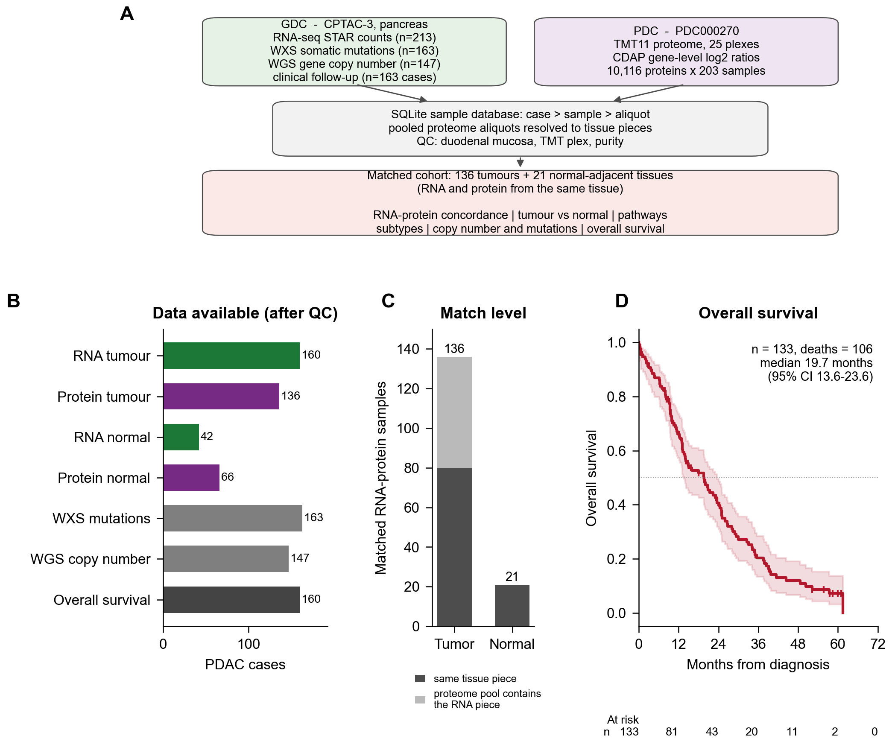
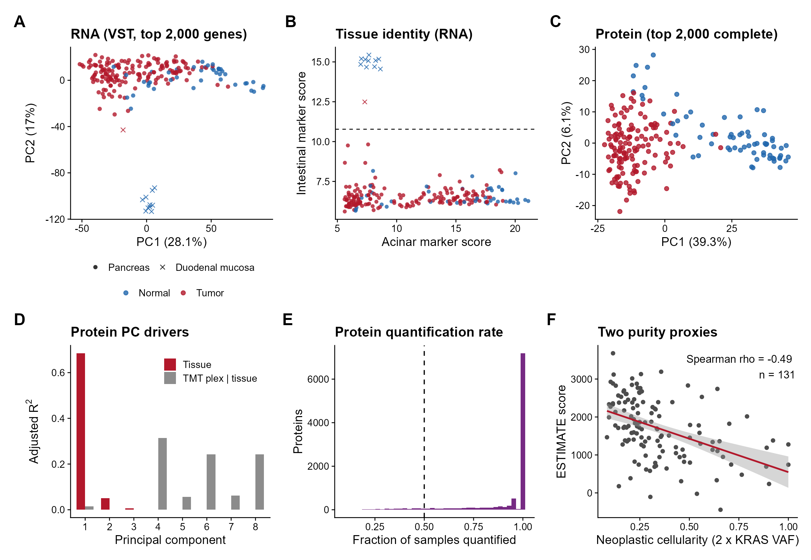
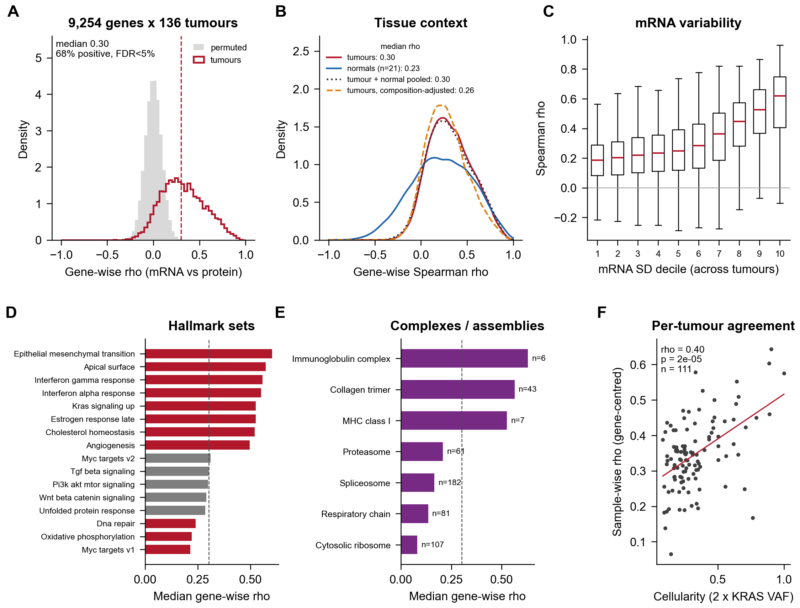
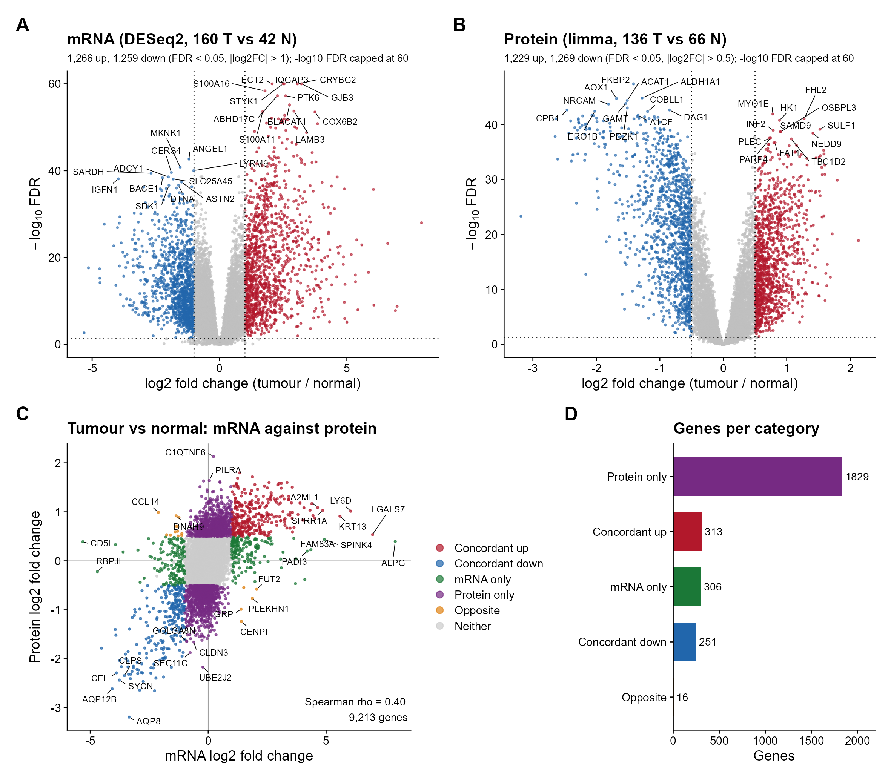
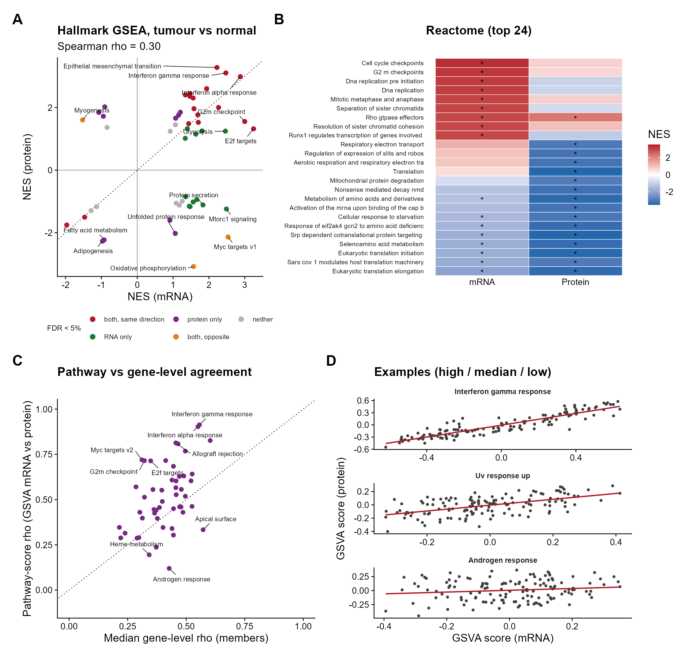
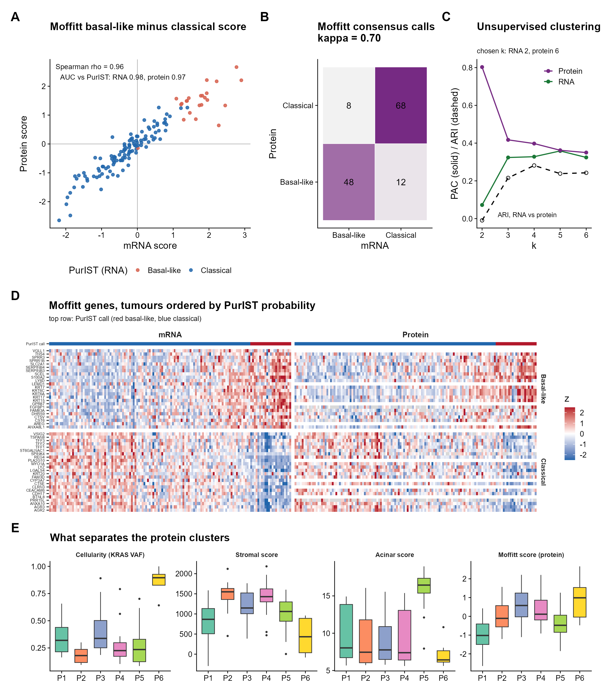
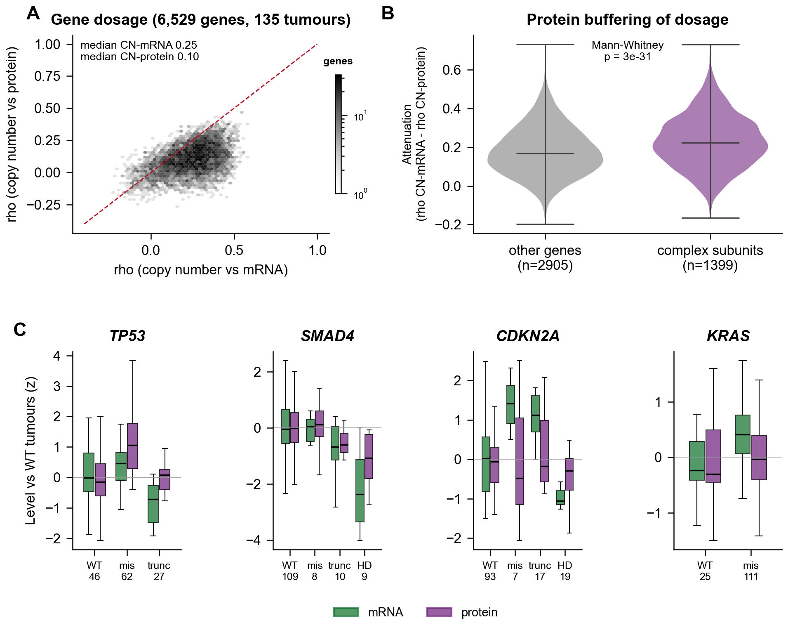
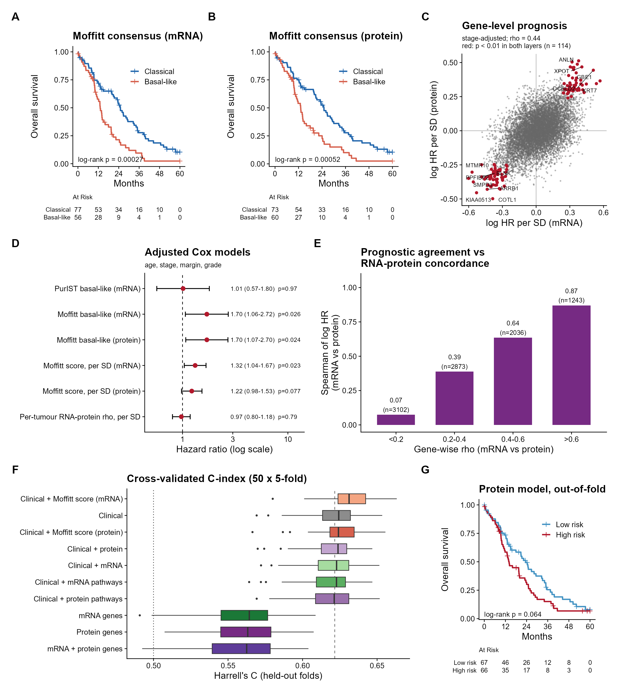

# PDAC-RNA-Protein-Concordance

**Where do mRNA and protein agree in pancreatic cancer, where do they
disagree, and does it matter for subtypes, pathways and survival?**

An independent, fully reproducible re-analysis of the CPTAC-3 pancreatic
ductal adenocarcinoma (PDAC) discovery cohort (Cao et al., *Cell* 2021),
integrating RNA-seq, TMT proteomics, somatic mutations, copy number and
overall survival from the NCI Genomic Data Commons (GDC) and Proteomic Data
Commons (PDC). Every sample link between the two portals is made explicitly
and stored in an SQLite database.

`R` · `Python` · `Bioconductor` · `DESeq2` · `limma` · `fgsea` · `GSVA` ·
`ConsensusClusterPlus` · `survival` · `glmnet` · `SQLite`

---

## Key findings

| | |
|---|---|
| **Cohort** | 136 PDAC tumours with RNA and protein from the same tissue (80 same piece, 56 pooled pieces) + 21 matched normal-adjacent tissues; 133 patients with survival (105 deaths within 5 years) |
| **Quality control** | 10 "normal pancreas" samples and 1 tumour were **duodenal mucosa** (Whipple resections include duodenum), detected with an intestinal marker score and excluded |
| **Concordance** | Median gene-wise mRNA-protein Spearman rho **0.30** (permutation null 0.00); 68% of 9,254 genes significantly coupled. Highest: EMT, collagens, interferon/MHC, immunoglobulins. Lowest: ribosome, respiratory chain, spliceosome, proteasome. Removing tissue composition only lowers the median to 0.26 |
| **Tumour coherence** | Per-tumour mRNA-protein agreement rises with cancer-cell content (rho 0.40 with KRAS-VAF cellularity); pooled and single-piece proteomes are equally coherent |
| **DNA → protein** | Copy-number changes reach mRNA for 4,304 genes but protein for only 793; complex subunits are buffered most (p = 3e-31). TP53 missense raises **protein** (stabilisation), TP53 truncation lowers **mRNA** (nonsense-mediated decay); SMAD4 deletion is visible in both layers |
| **Tumour vs normal** | 2,525 mRNA and 2,498 protein changes; fold changes correlate at rho 0.40 (0.49 on identical samples). OXPHOS and MYC targets go up in mRNA but down in protein: loss of acinar protein mass vs per-cell programmes |
| **Pathways** | Pathway activity (GSVA) agrees better between layers than single genes (median rho 0.50 vs 0.43, p = 9e-5) |
| **Subtypes** | The Moffitt basal-like/classical axis is the same at both layers (score rho 0.96; kappa 0.70) and **equally prognostic by protein** (adjusted HR 1.70 in both). Unsupervised clusters mainly track tissue composition |
| **Prognosis** | Genes that are concordant are prognostic in both layers (log-HR agreement 0.87 for rho > 0.6 vs 0.07 for rho < 0.2). In 50 × 5-fold CV, genome-wide elastic-net models from mRNA, protein or both **do not beat** clinical pathology (C 0.62); a single pre-specified Moffitt score does (C 0.63, better in 84% of repeats) |

## Figures

| | |
|---|---|
|  Fig 1. Design, data availability, matching, survival |  Fig 2. QC, duodenal contamination, plex effects, purity |
|  Fig 3. mRNA-protein concordance |  Fig 4. Tumour vs normal in both layers |
|  Fig 5. Pathway-level agreement |  Fig 6. Subtypes in mRNA and protein |
|  Fig 7. Copy-number and driver effects |  Fig 8. Survival and prognostic models |

Every figure is available as SVG, 300 dpi PNG and JPG. A panel-by-panel guide
is in [`docs/figures.md`](docs/figures.md).

## Relation to published work

The cohort was published by the CPTAC consortium in Cao et al., *Cell*
184:5031 (2021), which reported mRNA-protein correlations, subtypes and
phosphoproteomics. Later studies re-used it for pan-cancer proteogenomics
and PDAC subtyping. This repository is an **independent re-analysis** from the
public files: it does not use the consortium's harmonised tables, makes the
GDC-PDC sample matching explicit, adds a tissue-identity QC, quantifies
composition effects on concordance, and tests (with cross-validation)
whether the proteome adds prognostic value. Results agree with the original
where they overlap (median gene-wise rho 0.30 in tumours and 0.23 in NATs here, vs 0.36 and 0.26 reported). See
[`manuscript/manuscript.md`](manuscript/manuscript.md) for the full write-up
and verified references.

## Repository layout

```
config/config.yaml        cohort IDs, paths, thresholds, seeds
src/cancerpg/             Python package: GDC/PDC clients, matching, stats, plotting
R/                        R helpers (data access, figure theme, survival coding)
scripts/python/, scripts/R/   pipeline steps 00-14
run_pipeline.py           runs all steps in order, logs to logs/
db/schema.sql             SQLite schema (database built by steps 03 and 14)
resources/                pinned PDAC subtype signatures and PurIST model
results/tables/           all result tables (TSV)
results/figures/          all figures (SVG/PNG/JPG)
manuscript/               manuscript, references (DOIs verified)
docs/                     methods, figure guide, data provenance
tests/                    pytest + testthat
envs/, renv.lock          exact software environment
data/                     downloaded/derived data (not committed; see data/README.md)
```

## Reproduce

Requirements: R 4.5.x, conda, ~3 GB disk, internet access to GDC/PDC.

```bash
conda env create -p ./.cache/env -f envs/environment.yml
conda activate ./.cache/env
Rscript envs/setup_r_env.R          # or: Rscript -e "renv::restore()"
python run_pipeline.py              # all steps, ~1 h
python run_pipeline.py --list       # list steps
python -m pytest tests/python -q
```

Set `RSCRIPT` to the full path of `Rscript` if it is not on `PATH`. Software
versions are frozen (R 4.5.2, Bioconductor 3.22, CRAN snapshot 2025-12-15,
Python 3.12); random seeds are in `config/config.yaml`.

## Data and licence

Data: CPTAC-3 open-access files from the GDC and PDC, used under the NCI data
use policies; please cite Cao et al. (2021) when using the cohort. Code: MIT
licence (see `LICENSE`).

## Author

Muhammad Ahmed Mushtaq
